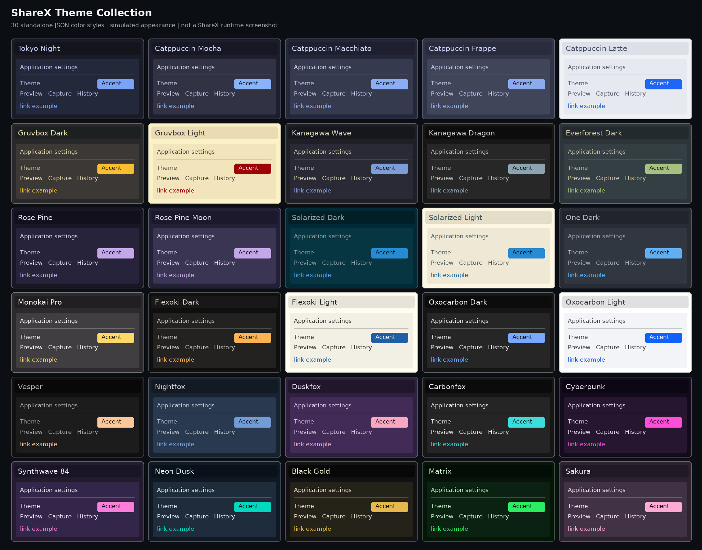
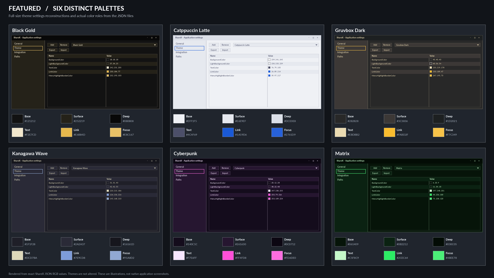
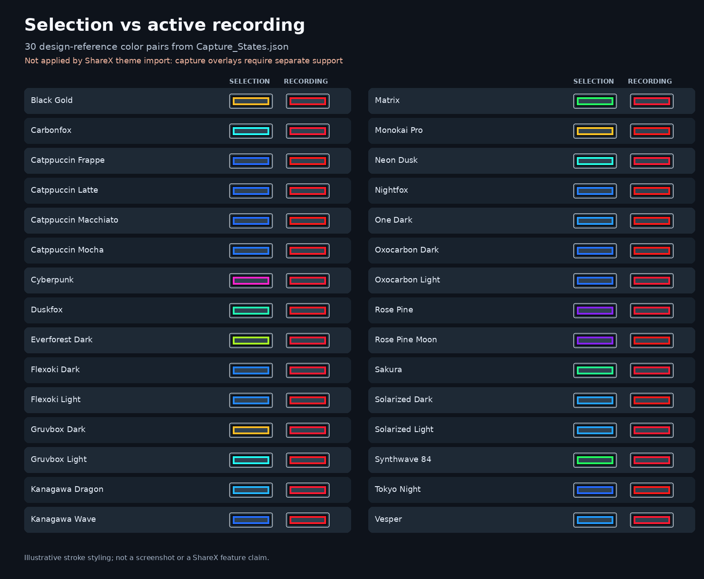
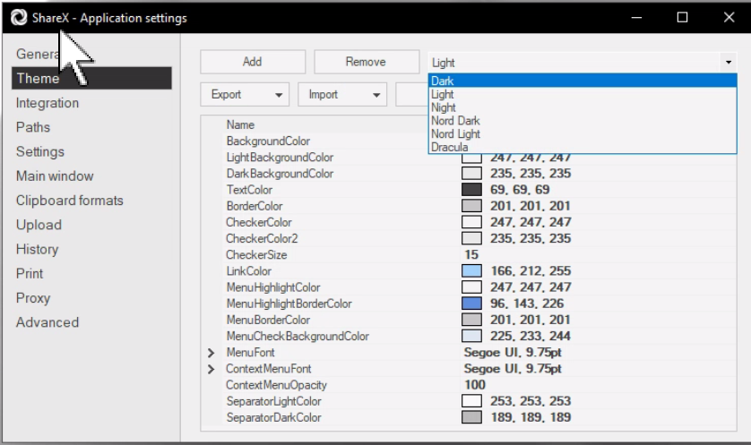

# ShareX Themes

**30 standalone JSON color themes for ShareX.** A mix of dark, light, muted, and high-color styles with distinct names and settings palettes.



> **Preview accuracy:** These are color simulations generated from the theme JSON values, **not screenshots captured from a running ShareX installation**. The actual appearance depends on the ShareX version and Windows rendering.

## Contents

- **30 individual theme files:** [`themes/`](themes/) contains one ShareX-style JSON object per theme.
- **Consolidated catalog:** [`ShareXThemes_30.json`](ShareXThemes_30.json) contains all 30 in a `Themes` array, for inspection or use in a separate configuration-merging workflow. It is **not a native one-click theme import file**.
- **Capture-state reference:** [`Capture_States.json`](Capture_States.json) specifies separate vivid colors for region selection and ongoing video/GIF recording. These are **proposed colors**, not active ShareX theme settings.
- **Visual assets:** [`assets/`](assets/) contains the overview, detailed simulated previews, capture color comparison, and ShareX theme-settings screenshot.

## Gallery

### Featured palettes



### Region selection and active recording: separate colors



**Selection** is the visible outline of the area you are drawing for a screenshot, video, or GIF capture. **Active recording** is the persistent outline while video or GIF capture is running. The color definitions deliberately distinguish these states, but **ShareX does not load these capture-state definitions through the ordinary theme JSON importer**. The image demonstrates a *proposed* rendering treatment, including contrasting edges, not a current feature.

## Installation

### Import an individual theme

1. Download this repository's ZIP from GitHub, or download an individual file from [`themes/`](themes/).
2. Extract the repository archive if necessary.
3. In ShareX, open **Application settings > Theme**.
4. Choose **Import > From File**, then select a `.json` file from `themes/`.
5. Select the newly imported theme from ShareX's theme list.
6. Repeat to import more themes.



*Theme settings screenshot is a user-provided UI reference. Menus and layout may differ in newer ShareX versions.*

**One file vs 30 files:** The ShareX individual-theme importer expects a single theme object. The bundled `ShareXThemes_30.json` instead contains `{ "Themes": [...] }` and is **not** a supported replacement for importing a theme file. Do not import it through **Theme > Import > From File**, and do not overwrite your complete ShareX application configuration with it. Backup any configuration before advanced merging.

## Theme catalog

| Theme | Background | Text | Link |
|:--|:--|:--|:--|
| [Black Gold](themes/Black_Gold.json) | `#121212` | `#F2E7CD` | `#E6B84D` |
| [Carbonfox](themes/Carbonfox.json) | `#161616` | `#F2F4F8` | `#3DDBD9` |
| [Catppuccin Frappe](themes/Catppuccin_Frappe.json) | `#303446` | `#C6D0F5` | `#9AB5F0` |
| [Catppuccin Latte](themes/Catppuccin_Latte.json) | `#EFF1F5` | `#4C4F69` | `#1A59D6` |
| [Catppuccin Macchiato](themes/Catppuccin_Macchiato.json) | `#24273A` | `#CAD3F5` | `#8AADF4` |
| [Catppuccin Mocha](themes/Catppuccin_Mocha.json) | `#1E1E2E` | `#CDD6F4` | `#89B4FA` |
| [Cyberpunk](themes/Cyberpunk.json) | `#140C1C` | `#F7E6FF` | `#FF4FD8` |
| [Duskfox](themes/Duskfox.json) | `#2E203E` | `#E1D2E6` | `#F6A7C1` |
| [Everforest Dark](themes/Everforest_Dark.json) | `#2D353B` | `#D3C6AA` | `#A7C080` |
| [Flexoki Dark](themes/Flexoki_Dark.json) | `#100F0F` | `#CECDC3` | `#FFB454` |
| [Flexoki Light](themes/Flexoki_Light.json) | `#FFFCF0` | `#282726` | `#205EA6` |
| [Gruvbox Dark](themes/Gruvbox_Dark.json) | `#282828` | `#EBDBB2` | `#FABD2F` |
| [Gruvbox Light](themes/Gruvbox_Light.json) | `#FBF1C7` | `#3C3836` | `#9D0006` |
| [Kanagawa Dragon](themes/Kanagawa_Dragon.json) | `#181616` | `#C5C9C5` | `#8BA4B0` |
| [Kanagawa Wave](themes/Kanagawa_Wave.json) | `#1F1F28` | `#DCD7BA` | `#7E9CD8` |
| [Matrix](themes/Matrix.json) | `#061409` | `#C5F8C9` | `#2CEC64` |
| [Monokai Pro](themes/Monokai_Pro.json) | `#2D2A2E` | `#FCFCFA` | `#FFD866` |
| [Neon Dusk](themes/Neon_Dusk.json) | `#101923` | `#E4F4F5` | `#00D9C0` |
| [Nightfox](themes/Nightfox.json) | `#192330` | `#CDCECF` | `#7CA3D9` |
| [One Dark](themes/One_Dark.json) | `#282C34` | `#ABB2BF` | `#61AFEF` |
| [Oxocarbon Dark](themes/Oxocarbon_Dark.json) | `#161616` | `#F2F4F8` | `#78A9FF` |
| [Oxocarbon Light](themes/Oxocarbon_Light.json) | `#FFFFFF` | `#393939` | `#0D56DE` |
| [Rose Pine](themes/Rose_Pine.json) | `#191724` | `#E0DEF4` | `#C4A7E7` |
| [Rose Pine Moon](themes/Rose_Pine_Moon.json) | `#232136` | `#E0DEF4` | `#C4A7E7` |
| [Sakura](themes/Sakura.json) | `#2D2230` | `#FBE7F1` | `#FFAAD5` |
| [Solarized Dark](themes/Solarized_Dark.json) | `#002B36` | `#93A1A1` | `#4C9FDA` |
| [Solarized Light](themes/Solarized_Light.json) | `#FDF6E3` | `#40575E` | `#1C6598` |
| [Synthwave 84](themes/Synthwave_84.json) | `#241B2F` | `#F6EAFA` | `#FF7EDB` |
| [Tokyo Night](themes/Tokyo_Night.json) | `#1A1B26` | `#C0CAF5` | `#7AA2F7` |
| [Vesper](themes/Vesper.json) | `#101010` | `#B0B0B0` | `#FFC799` |

The table lists actual RGB values converted to hex from the supplied theme files. It does not claim pixel-perfect application rendering.

## Region selection and recording visibility

The collection includes a reference palette for separate capture states:

| State | Scope | Status |
|:--|:--|:--|
| **Selection tool** | Screenshot, video-region, and GIF-region selection | Design reference only |
| **Active recording** | Active video and GIF recording boundary | Design reference only |

Each capture reference includes a recommended primary color, contrasting light and dark stroke edges, and a nominal 3-pixel primary stroke. These values live in `Capture_States.json`. They **do not modify** the native capture overlay or its width, and the conventional theme `BorderColor` properties are unrelated to this functionality. Applying those capture colors automatically would require supported application-side changes.

## Technical notes

- The theme files preserve the **individual `ShareXTheme` JSON shape** exemplified by the supplied `NotNord2.json` reference: `Name`, RGB-string colors, checker size, fonts, and context-menu opacity.
- The consolidated catalog uses a separate `Themes` array, which should not be confused with one individual import file.
- The palette and capture-state JSON are data files. No application binary, installer, background process, or external connection is included.
- Validation of this repository covers JSON parsing, count, names, and file correspondence. **Native ShareX import and capture-outline behavior have not been tested on a target Windows installation.**

## Repository layout

```text
ShareXThemes/
  README.md
  ShareXThemes_30.json
  Capture_States.json
  themes/
    Black_Gold.json
    Carbonfox.json
    ... (30 individual files total)
  assets/
    themes-overview.png
    featured-palettes.png
    capture-state-reference.png
    sharex-theme-settings.png
```

## About and attribution

This is an independent ShareX theme collection. Theme names refer to their respective color-style families and do not indicate endorsement by ShareX or by the creators of those palettes. The previews were rendered from the included JSON values.

**ShareX official sources:** [ShareX project](https://github.com/ShareX/ShareX) · [ShareX theme model](https://github.com/ShareX/ShareX/blob/develop/ShareX.HelpersLib/ShareXTheme.cs) · [ShareX changelog](https://getsharex.com/changelog).

